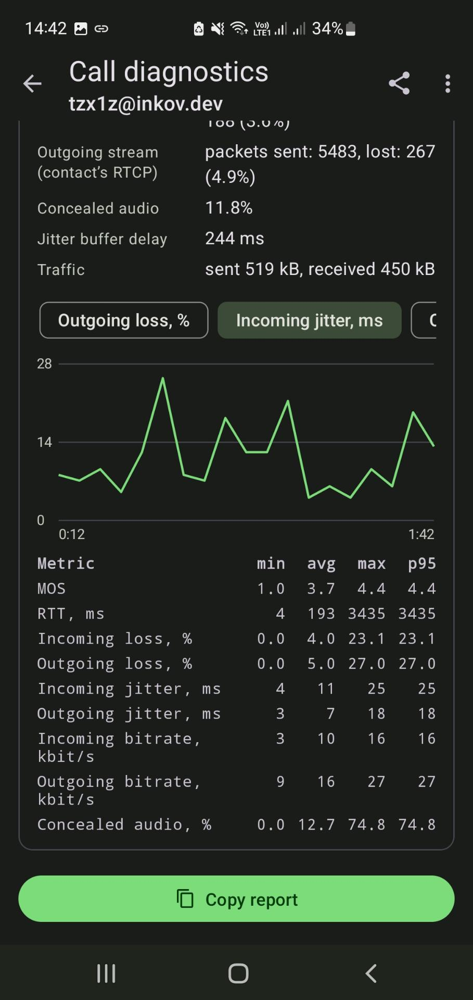
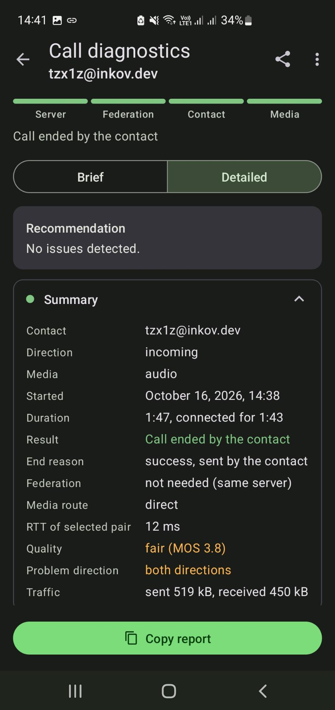
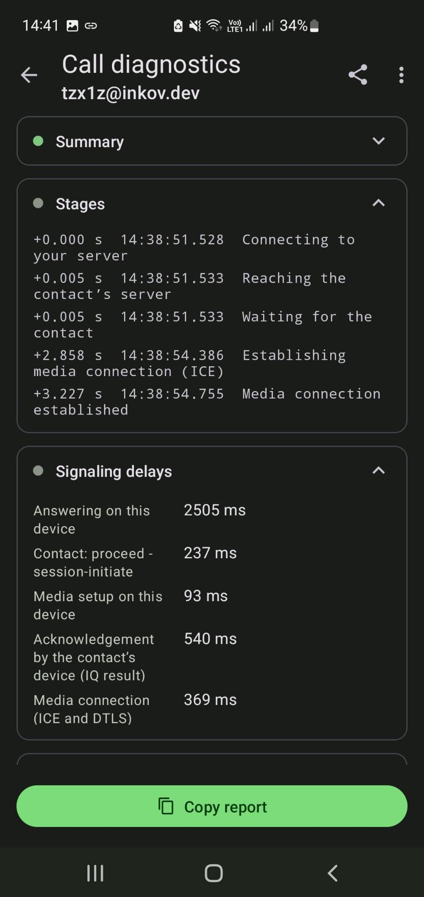
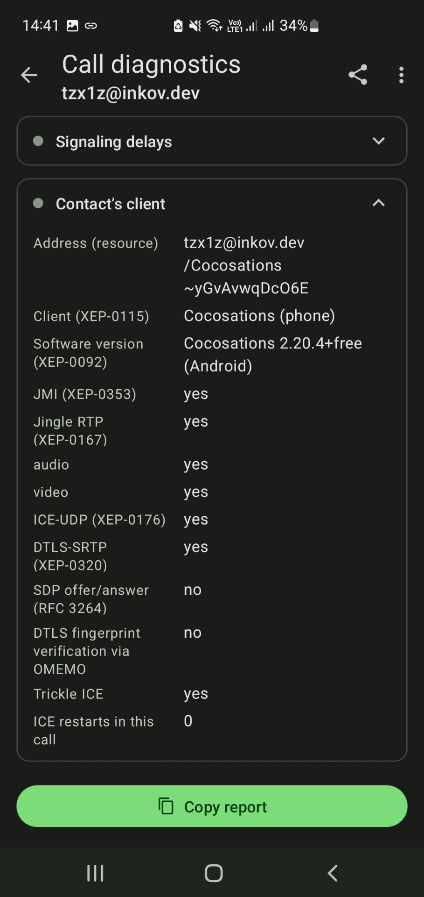
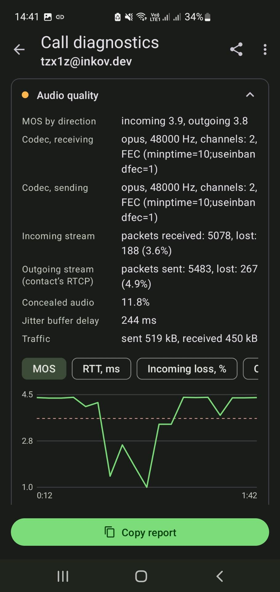
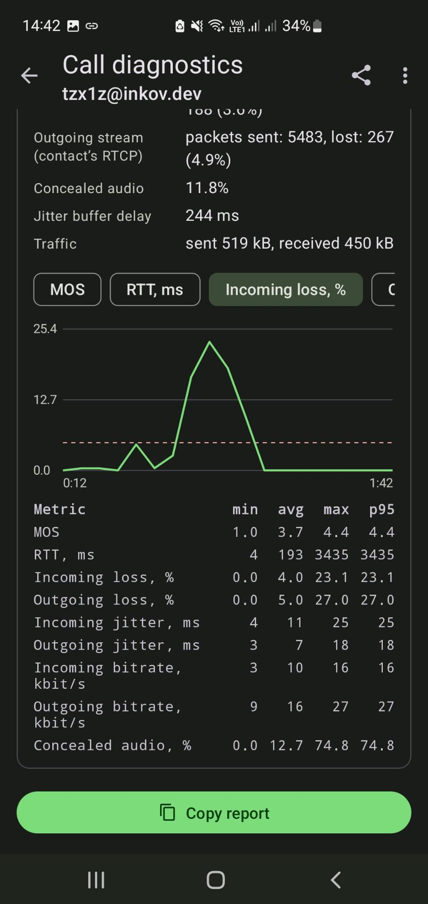
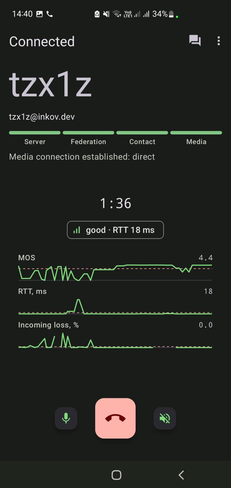

<h1 align="center">Cocosations</h1>

<p align="center">A fork of <a href="https://codeberg.org/iNPUTmice/Conversations">Conversations</a> with call diagnostics and last activity of contacts</p>

Cocosations is a Jabber/XMPP client for Android based on
[Conversations](https://codeberg.org/iNPUTmice/Conversations) (GPLv3). The
protocol, encryption and all other features come from the original unchanged.

| | |
|---|---|
| Application ID | `dev.inkov.cocosations` |
| Based on | Conversations 2.20.4 |
| License | GPLv3, same as the original |
| Source code | https://github.com/tzx1z/cocosations |
| Fork author | Evgeny Inkov |

Cocosations installs next to Conversations: the apps have different
application IDs, their data and accounts do not overlap.

## Screenshots

<p align="center">







</p>

1. Call screen: connection stages, media route, quality indicator and charts.
2. Call report: stages, recommendation and summary.
3. Report: stage timing and signaling delays.
4. Report: the contact's client and its capabilities.
5. Report: audio quality by direction and the MOS chart.
6. Report: incoming packet loss chart and metric statistics (min, avg, max, p95).
7. Report: incoming jitter chart and metric statistics.

## Installation

Via F-Droid: add the repository https://fdroid.inkov.dev/repo. That page has a
QR code and a link with the repository key fingerprint, which can be opened on
a phone with F-Droid installed.

The APKs are signed with the author's key, SHA-256 of the certificate:

```
015df71201ff6e6ca0db7b666bd4ae4fb24386199e80e4475f70a4c6233eb78f
```

Builds are reproducible: the APKs are built from the `v*` tags of this
repository in the same environment as the F-Droid buildserver (Debian trixie,
OpenJDK 25, NDK r28c).

## Author

Evgeny Inkov

- email: me@inkov.dev
- XMPP: tzx1z@inkov.dev
- website: https://inkov.dev

Bugs and suggestions: https://github.com/tzx1z/cocosations/issues.
Crash reports (with the user's consent) are sent as an XMPP message to
bugs@inkov.dev.

## Differences from Conversations

### Step-by-step call diagnostics

The call screen shows a progress bar of four segments below the contact's
name. Completed stages are green, the current one pulses, upcoming ones are
grey. On failure the segment of the stage turns red and the reason is shown
below the bar.

| Segment | Stage (`CallStage`) | Confirmed by | Failure |
|---|---|---|---|
| Server | `CONNECTING_TO_SERVER` | the server acknowledged the JMI `propose` via XEP-0198 (without stream management: the account is online) | `FAILED_SERVER`: no acknowledgement from the own server, no network, c2s connection lost during the call |
| Federation | `RESOLVING_REMOTE_SERVER` | a response from the contact's server: the contact's presence, XEP-0199 ping of the domain, a receipt or `ringing` | `FAILED_FEDERATION`: `remote-server-not-found`, `remote-server-timeout`, no response from the remote server before the timeout |
| Contact | `WAITING_FOR_PEER` | `proceed` (JMI) and `session-accept` | `FAILED_DELIVERY`: the contact is offline (`service-unavailable` and similar), declined the call or did not answer |
| Media | `ICE_NEGOTIATION` | `PeerConnectionState.CONNECTED` | `FAILED_ICE`: ICE failed, media connection lost |

If both accounts are on the same server, the federation stage passes at once.
For an incoming call the first two stages count as passed: the contact's
message has already arrived.

A report is saved for every outgoing call and every accepted incoming call
(successful, cancelled or failed), but it does not open by itself. On the call
screen, during the call and after a failure, it is available from the "Call
diagnostics" menu item; after the call, from the chat menu (see below). The
report contains:

- the failed stage, the reason and the XMPP error condition;
- the media type (audio, video) and its changes during the call;
- what confirmed federation: the contact's presence, a server ping
  (XEP-0199), delivery to the device, acceptance or rejection of the call;
- the media route: direct, direct in the local network, via the own TURN, via
  the contact's TURN or via both;
- RTT of the selected pair and the candidate pairs from `getStats()`: check
  state, nominated, number of requests and responses. Failed pairs show why
  the direct path did not work;
- the state of ICE, PeerConnection and candidate gathering;
- STUN/TURN server addresses (without credentials);
- local candidates with the server they came from, remote candidates, the
  selected pair;
- a NAT type estimate (no NAT, cone, symmetric, UDP blocked, CGNAT);
- a recommendation for the user and the event timeline.

Pair statistics are collected every 5 seconds from the start of ICE, and also
when the ICE state or the selected pair changes. The route is also shown on
the call screen.

#### Signaling and the contact

Timeline events are typed: each event has a direction (`→` sent, `←`
received, `·` local), the time since the start of the call and the time of day
with milliseconds. Event labels are translated, technical details (addresses,
states, error conditions) are shown as is.

The "Signaling delays" section measures the time between steps of the
timeline.

For an outgoing call:

| Step | From | To |
|---|---|---|
| Own server | `propose` | server acknowledgement (XEP-0198) |
| Contact's server and delivery to the device | acknowledgement or `propose` | `ringing` or receipt |
| Contact's answer | delivery | `proceed` |
| Media setup on this device | `proceed` | `session-initiate` |
| Acknowledgement by the contact's device | `session-initiate` | IQ result |
| Media setup on the contact's side | `session-initiate` | `session-accept` |
| Media connection | `session-accept` | PeerConnection CONNECTED |

For an incoming call: answering on this device, `proceed - session-initiate`
on the contact's side, media setup here, acknowledgement of `session-accept`
and the media connection.

The "Contact's client" section: the full address of the device that accepted
the call, the client from caps (XEP-0115, from the disco cache), the software
version from an XEP-0092 request and supported features: JMI, Jingle RTP,
audio, video, ICE-UDP, DTLS-SRTP, SDP offer/answer (if supported, candidates
go into the offer and trickle ICE is not used), DTLS fingerprint verification
via OMEMO. ICE restart is not announced in disco, so the number of ICE
restarts in this call is shown instead.

"End reason" is the condition from the Jingle `<reason>` (`busy`, `decline`,
`connectivity-error`, `failed-application`, `security-error`, `gone`,
`timeout` and others) with its `<text>`, or a JMI `reject` or `retract`, and
the side that sent it. The first reason counts.

The ICE section shows the result of the XEP-0215 STUN/TURN request: the number
of servers and the response time, an empty list, an error with its condition
or no support on the server, and the nearest expiry of the TURN credentials
from the `expires` attribute. ICE server errors from `onIceCandidateError`
(for example, `401 Unauthorized` or `701` for TURN) are grouped by address and
code with a repeat count.

#### Audio quality

Audio streams come from the same `getStats()`:

- `inbound-rtp`: the codec and its parameters (`sdpFmtpLine`, FEC, DTX),
  received and lost packets, jitter, the average jitter buffer delay
  (`jitterBufferDelay / jitterBufferEmittedCount`), the share of concealed
  audio (`concealedSamples / totalSamplesReceived`);
- `outbound-rtp`: sent packets and bitrate;
- `remote-inbound-rtp`: loss (`fractionLost`), jitter and RTT from the
  contact's RTCP reports, that is, the quality of the outgoing audio on the
  contact's side;
- `transport`: traffic of the call.

Every 5 seconds a point of a time series is added to the report: RTT, loss and
jitter in both directions, bitrate, concealment and MOS. The series keeps at
most 720 points: on a long call it is thinned out by half and the interval
between points grows. For each metric the report shows the minimum, average,
maximum and p95.

MOS is calculated with a simplified E-model (ITU-T G.107) separately for each
direction: the one-way delay (RTT / 2), the jitter buffer (2 x jitter) and
10 ms for the codec lower the R factor, each percent of loss lowers it by 2.5.
Rating: MOS 4.0 or higher is good, 3.6 or higher is fair, lower is poor. If one
direction is worse than the other by more than 0.2, the report marks it as the
problem direction: incoming audio (you hear the contact worse) or outgoing
audio (the contact hears you worse).

Moments when loss in either direction exceeds 5% or RTT exceeds 300 ms are
added to the timeline as quality degradation, the return to normal as
recovery.

Reports are kept in the call log: main screen - menu - "Call log". It lists
the reports of all accounts, newest first, with a filter: all, successful,
failed, not connected, poor quality (rated fair or poor). Each row shows the
direction, contact, date, media type, connection time, result and quality
rating. The "Clear call log" menu item deletes all reports and logs.

The call report can also be opened:

- from the three-dot menu of a chat and of a contact's profile: "Last call
  report";
- by a long press on a call message in a chat: "Call diagnostics". The item
  is shown only if the report of that call is saved or the call took place in
  the current session. The `remoteMsgId` of a call message equals the Jingle
  session id.

If the call is in progress or took place after the app started, the report
from memory is shown, otherwise the saved one. Missed and declined incoming
calls are not saved.

Reports are stored as JSON files in the app's private folder
(`files/cocosations_call_journal/<account uuid>/`), one file per call named
`<start in ms>_<contact hash>_<session id hash>.json` (the first 16 characters
of SHA-256). Lookups by contact and by call use the file names without reading
the contents. A set number of the latest reports across all accounts is kept
(Settings - Privacy - Call diagnostics - "Call reports to keep", from 1 to 500,
1 by default); extra ones are deleted after a new report is saved. The
database schema does not change, the files are not included in backups and
are deleted together with the account. The `cocosations_call_reports` folder
of the previous version (one report per contact, a different format) is
deleted on the first access to the call log.

The report screen consists of section cards: summary, stages, signaling
delays, contact's client, audio quality, ICE, local and remote candidates,
candidate pairs, timeline. The dot next to a section title shows its state:
green is normal, yellow means warnings, red means failure. A tap on the title
collapses the section; candidates, pairs and the timeline are collapsed by
default. The "Brief / Detailed" switch leaves only the stages, the
recommendation and the summary in brief mode, the choice is remembered.

The "Audio quality" section has a time series chart: MOS, RTT, loss, jitter,
bitrate and concealment are selected with chips, the dashed line shows the
degradation threshold. The text report has a min / avg / max / p95 table
instead of the chart.

The "Copy report" button copies the whole text. The screen menu has "Share as
text" and "Share as JSON". The JSON is the same format the report is stored
in, with indentation; the file is written to `cache/cocosations_share/` for a
short time and passed via FileProvider. The report contains IP addresses of
candidates: review it before publishing.

#### Call logging

Settings - Privacy - Call diagnostics - "Call log" (off by default). When
enabled, `logcat -v threadtime -T <call start> --pid=<pid>` runs for each call
and writes to `cache/cocosations_call_logs/` with rotation at 1 MB; up to five
parts are kept, that is, the end of a long call. The app can only read its own
logcat entries. libwebrtc output to logcat at INFO level is enabled as well
(`Logging.enableLogToDebugOutput`).

2 seconds after the call ends, when the session and WebRTC shutdown is already
logged, the parts are joined into a file next to the report in the call log:
the same name with the `.log` extension. The log is deleted together with the
report on rotation, when the call log is cleared and when the account is
deleted. An unanswered incoming call has no report, and its log is deleted.
The report menu has "Share call log", the call log marks such calls with
"log". The log contains addresses, JIDs and session identifiers.

#### Quality indicator on the call screen

During an audio call a chip with the connection level (three bars and a color
based on MOS) and the current RTT is shown below the duration. Below it are
three charts for the last minute: MOS, RTT and incoming packet loss, each with
a label and the current value. The line is built from every poll, the dashed
line is the degradation threshold (MOS 3.6, RTT 300 ms, loss 5%). The MOS
scale is 1 to 4.5; RTT is 0 to 360 ms and loss is 0 to 6%, both scales grow if
a value is higher. A tap on the chip or the charts opens a dialog with the
current route, MOS, RTT, loss, jitter, bitrate and concealment in both
directions; the dialog updates together with the indicator. While the call
screen is open, it extends the per-second `getStats()` polling (a 3-second
lease); after the screen is closed only the regular polling every 5 seconds
remains. In a video call the space below the duration is taken by the video,
and the indicator is not shown.

The NAT type is an estimate. It needs two observations of the external address
of one socket from different destination addresses:

- srflx candidates from different STUN servers;
- an srflx candidate from a STUN server and a relay candidate from a UDP TURN
  server: the `raddr` of the relay candidate holds the external address seen
  by the TURN server. WebRTC sends STUN and UDP TURN from the same socket.

If different servers see the same external address, the NAT is estimated as
cone, if different addresses, as symmetric. STUN and TURN on the same host and
port (the usual coturn setup) do not give a second observation: a symmetric NAT
also keeps the port for a single destination. In that case the report says
"behind NAT, type undetermined", and the server list in the report shows the reason. TCP
and TLS TURN allocations are not used for the estimate. Servers are compared
by host name and port, so two names of the same server are taken as different
servers.

#### Connection loss tone

If the media connection drops in the middle of a conversation, a short quiet
tone plays in the call audio: two notes down (660 and 440 Hz). When the
connection is back, two notes up (660 and 880 Hz). This way a person who talks
for a long time learns about the loss even if the contact is silently
listening. The tone goes through AudioTrack with `USAGE_VOICE_COMMUNICATION`,
that is, to the same device as the voice: earpiece, speakerphone or
Bluetooth.

The loss is detected by incoming audio: during a conversation the statistics of
the audio `RtpReceiver` are polled every 250 ms, and if `packetsReceived` does
not grow for 1 second, the loss tone plays. This is the same sign as a gap on
the incoming loss chart, so the tone matches the gap instead of waiting for
WebRTC to report a disconnect. Polling continues when the call screen is
closed. The counter is tracked from the first incoming packet. Recovery means
packets are flowing again.

The fallback is `PeerConnectionState`: `DISCONNECTED` or `FAILED` after an
established connection (WebRTC enters them after 2-3 seconds without responses
to ICE checks). Recovery by this path is `CONNECTED` again, including after an
ICE restart, if incoming audio is not stalled at that moment.

One loss plays one tone. If the call ends during a loss, there is no recovery
tone. If the contact stops sending RTP without a connection loss (clients that
stop sending while muted), the tone plays too: Conversations keeps sending
silence while muted. The answer tone `TONE_CDMA_ANSWER` plays only at the start
of the conversation: in the original it repeated on every reconnection.

#### Incoming calls via the Phone app

Settings - Notifications - "Incoming calls via the Phone app" (off by default,
available when call integration is enabled). It allows answering and declining
calls from a watch, a headset and in a car.

Normally the app's calls are self-managed: Telecom knows about them but drops
commands from other apps and devices for them. In Android 14 `acceptRingingCall`
and `endCall` from a watch app end with the log entry `self-mgd accept
ignored`, and a headset button only knows a short and a long press. With this
setting an incoming audio call is registered on a separate calling account with
`CAPABILITY_CALL_PROVIDER` (the `SystemDialerConnectionService` component). The
Phone app shows it and plays the ringtone, and Telecom passes answer, decline
and hang up from a watch, headsets and a car to the app as `onAnswer`,
`onReject` and `onDisconnect`. For such a call `PROPERTY_SELF_MANAGED` is
removed, `setAudioModeIsVoip(true)` is enabled (otherwise audio is routed as
for a carrier call) and reply with a message is removed: the system would send
it as an SMS to an `xmpp:` address.

The calling account has to be enabled once in the system call settings: the app
opens that screen when the setting is turned on. Until it is enabled, Telecom
answers `addNewIncomingCall` with a `SecurityException`, and the call is
registered as before, self-managed. Video calls and outgoing calls do not
change. Such calls appear in the system call history with an `xmpp:` address,
and the ringtone comes from the phone settings, not from the app.

### Call channel check

Opens from the chat menu of a contact (the check starts at once) and from the
account settings menu. It is meant for checking the channel before a call over
a VPN or a proxy and switching to another proxy if needed. The contact does not
take part in the check, no call is made, the microphone is not turned on. The
check takes up to a minute, its stages and intermediate results are shown on
the screen:

1. A STUN/TURN request to the own server via XEP-0215 (10-second timeout).
2. A separate `PeerConnection` with the same configuration as a call without
   trickle (`GATHER_ONCE`, host TCP candidates disabled) and a receive-only
   audio transceiver: the offer is needed only to gather candidates. Gathering
   runs until `IceGatheringState.COMPLETE`, for at most 15 seconds. Server
   errors come from `onIceCandidateError`.
3. A channel via TURN for each transport (UDP, TCP, TLS). Two `PeerConnection`s
   on the device with `iceTransportsType = RELAY` and only the TURN servers of
   that transport exchange SDP and candidates in memory. One sends the other
   300 packets of 120 bytes every 20 ms over an unordered DataChannel without
   retransmissions (`maxRetransmits = 0`). With SCTP and DTLS headers this is
   close to Opus RTP packets, and a one-way stream puts the same load on the
   device's link as a call. The traffic path is device - VPN/proxy - TURN -
   relay - relay - TURN - VPN/proxy - device, through the same server ports as
   a call via relay. A transport on which TURN gave no address during
   gathering is not checked. If a call starts, the remaining transports are
   skipped.

Channel metrics. The sender and the receiver share the same clock, so the delay
is the device - TURN - device path without a clock offset correction. Jitter
is calculated per RFC 3550 in arrival order, loss by packet numbers. MOS uses
the same simplified E-model as the call report. The loop delay is taken as the
one-way delay of a call: the loop travels the path to TURN in both directions,
like a call with a contact in the same kind of network through the same server.
From getStats come the selected candidate pair and the network type of the
local candidate (`networkAdapterType` and `vpn`): they show whether traffic
goes through the VPN.

If relay - relay does not connect while addresses are allocated, the check is
repeated with the second side without `RELAY`: its external address comes from
STUN. If data passes this way, the server does not forward traffic between its
own relay addresses (no hairpinning behind NAT, or the relay address is in the
coturn `denied-peer-ip`). Then the remaining transports are checked via relay
and the external address right away, and the verdict reports it.

Result:

- summary: the device network from `ConnectivityManager` (vpn, wifi,
  cellular, ethernet), the external address from STUN and TURN (with a VPN or
  a proxy, the address of its exit), the XEP-0215 response and the TURN
  credentials expiry, candidate gathering time, the NAT type estimate, CGNAT,
  IPv4 and IPv6 availability;
- the channel via TURN per transport: MOS, average delay, jitter, loss or the
  failure reason (TURN gave no address, data did not pass, the server does
  not offer it);
- channel details: connection and relay allocation time, delay (average, p95,
  maximum), received packets, network, path and the selected candidate pair;
- a comparison of the account's checks since the app started (up to 10):
  external address, time and MOS per transport. After a proxy change it shows
  what changed;
- TURN per transport from the gathering data, each STUN/TURN server (external
  address, relay address, error code and text), all local candidates.

The verdict is based on the channel a call via relay will choose: ICE prefers
relay over UDP, then TCP, then TLS, regardless of quality. By MOS the channel
is good, fair or poor; if another transport has better quality, the verdict
says so. If TURN allocated addresses but data did not pass on any transport, a
call via relay will not connect. If the channel was not checked, the verdict is
based on candidate gathering: the server provides no STUN/TURN, there is no
TURN, TURN did not allocate a relay, symmetric NAT without TURN.

The check covers only its own half of the path, up to its own TURN. The
contact's network and a direct connection to the contact are not checked. The
check runs only when the account is connected and does not start during a
call. The report is copied and shared as text from the menu. Results are kept
in memory until the app restarts.

### Last activity of contacts

- In the contact list next to the name: "online" (green dot) or "N min / h /
  d ago" (grey dot). For a connected but inactive contact (XEP-0319 idle) the
  time of last activity is shown.
- In the chat list for one-to-one chats: the same label between the name and
  the time of the last message. For visible rows of offline contacts an
  XEP-0012 request is sent as well, with the same rate limit.
- In the contact's profile: the exact date and time of last activity, and
  below it the data source and the result of the XEP-0012 request:
  - source: XEP-0319 (`idle` in presence), XEP-0256 (`jabber:iq:last` in
    presence), XEP-0203 (the `delay` stamp in an unavailable presence), the
    time the contact was last seen online, or XEP-0012, with the update time;
    after an app restart until the next update, "saved earlier";
  - XEP-0012 request: time and result (response received, the contact is
    online, no response, the server does not support or does not disclose the
    logout time, no access, another error with the XMPP condition); without a
    presence subscription to the contact the request is not sent, and the
    profile says so.

  The source information is kept in memory until the app restarts.
- In the chat title: the time of last activity, including offline contacts.

Data sources, by priority:

1. XEP-0319 `<idle since="..."/>` in presence.
2. XEP-0256 `<query xmlns="jabber:iq:last" seconds="..."/>` in presence,
   counted from `<delay/>` or from the time of receipt. In an unavailable
   presence the server passes the user's logout time this way.
3. XEP-0012 `jabber:iq:last` to the bare JID of an offline contact: the server
   returns the time since logout. The request is sent only for contacts visible
   in the list with a subscription, and at most once in 15 minutes per contact.

XEP-0312 (PubSub Since) is not about activity time, so XEP-0012 is used for
offline contacts.

The time is stored in the `contacts.last_time` column: it exists in the
database schema of the original but is not used. No migration or database
version change is needed.

If the contact's server and client do not support these XEPs, no badge is shown
for an offline contact.

### Privacy

The "Show last seen" setting (Settings - Privacy, off by default) controls only
publishing your own activity: `<idle/>` in presence, responses to XEP-0012 and
the features in disco. The activity of others is always shown.

The logout time returned by the server (XEP-0012 to the bare JID, XEP-0256 in
response to a probe) is produced by the server itself. A client setting does
not hide it: it depends on the server modules (`mod_lastactivity` in Prosody,
`mod_last` in ejabberd).

## Building

JDK 25 (Gradle toolchain) and the Android SDK with platform 37 are required.
Gradle downloads missing SDK components itself once the license is accepted.

```
./gradlew assembleConversationsFreeDebug
./gradlew testConversationsFreeDebugUnitTest
./gradlew assembleConversationsFreeRelease
```

The release build is signed with the key from `signing.properties`, as in the
original. Without this file the APK is unsigned. The file is in `.gitignore`,
the key is kept outside the repository:

```
keystore=/path/to/cocosations-release.p12
keystore.password=<keystore and key password>
keystore.alias=cocosations
```

The keystore and key passwords are the same: in PKCS12 they match. An installed
app can only be updated with an APK signed with the same key.

APKs for publishing are built in a container with the same JDK and NDK as the
F-Droid buildserver: a build with another JDK or NDK produces different
`classes.dex` and `.so` files.

The Java packages stay `eu.siacs.conversations`, so that upstream changes can
still be merged without mass conflicts. New resources of the fork live in files
and names with the `cocosations_` prefix.

---

Below is the README of the original project.

<h1 align="center">Conversations</h1>

<p align="center">Conversations: the very last word in instant messaging</p>

<p align="center">
  <a href="https://play.google.com/store/apps/details?id=eu.siacs.conversations&amp;referrer=utm_source%3Dcodeberg">
    
  </a>
  <a href="https://f-droid.org/packages/eu.siacs.conversations">
    
  </a>
</p>

<p align="center">


</p>

A free and open-source Jabber/XMPP client for Android. Easy to use, reliable, and battery-friendly. With built-in support for images, group chats, and location sharing. End-to-end encrypted by default. Connects to all modern Jabber, XMPP, and Snikket servers.


## Features
* End-to-end encryption with [OMEMO](http://conversations.im/omemo/) or [OpenPGP](http://openpgp.org/about/)
* Send and receive images and other kinds of files
* Encrypted audio and video calls ([DTLS-SRTP](https://help.conversations.im))
* Advanced machine-in-the-middle detection via channel binding (requires opt-in)
* Share your location
* Send voice messages
* Emoji reactions
* Indication when your contact has read your message
* Intuitive UI that follows Android design guidelines (Material Design 3 with Dynamic Colors)
* High-resolution contact photos (avatars)
* Synchronizes with desktop clients ([Gajim](https://gajim.org) and [Dino](https://dino.im))
* Private group chats and public conferences (with support for bookmarks)
* Message moderation for admins in public conferences
* Address book integration
* Multiple accounts (unified inbox)
* Deliver push notifications to other [compatible apps](https://unifiedpush.org/users/apps/) like Tusky, Ltt.rs, DAVx⁵ and Fennec via [UnifiedPush](https://unifiedpush.org/)
* Very low impact on battery life


***Note:** Some of these features require server support. Go to account details and select 'Server Info' from the overflow menu to see if your server has all necessary extensions.*

## Design principles
* Be as beautiful and easy to use as possible without sacrificing security or privacy
* Rely on existing, well-established protocols
* Do not require a Google account or specifically Firebase Cloud Messaging (FCM)
* Require as few permissions as possible

## FAQ

### How do I install Conversations?

Conversations is entirely open source and licensed under GPLv3. So if you are a
software developer you can check out the sources from Codeberg and use Gradle to
build your APK file.

Conversations is available on [Google Play](https://play.google.com/store/apps/details?id=eu.siacs.conversations) and on [F-Droid](https://f-droid.org/en/packages/eu.siacs.conversations/).

If you want to use F-Droid you can use the developer’s [F-Droid repository](https://fdroid.link/#https://gultsch.dev/fdroid/repo?fingerprint=9C2E57C85C279E5E1A427F6E87927FC1E2278F62D61D7FCEFDE9346E568CCF86) instead of
the official one:
```
https://gultsch.dev/fdroid/repo?fingerprint=9c2e57c85c279e5e1a427f6e87927fc1e2278f62d61d7fcefde9346e568ccf86
```

### How do I create an account?
XMPP, like email, is a federated protocol, which means that there is not one company you can create an *official XMPP account* with. Instead there are hundreds, or even thousands, of providers out there. One of those providers is our very own [conversations.im](https://account.conversations.im). If you don’t like to use *conversations.im* use a web search engine of your choice to find another provider. Or maybe your university has one. Or you can run your own. Or ask a friend to run one. Once you've found one, you can use Conversations to create an account. Just select *register new account* on server within the create account dialog.

#### Domain hosting
Using your own domain not only gives you a more recognizable Jabber ID, it also gives you the flexibility to migrate your account between different XMPP providers. This is a good compromise between the responsibilities of having to operate your own server and the downsides of being dependent on a single provider.

Learn more about [conversations.im Jabber/XMPP domain hosting](https://account.conversations.im/domain/). 

#### Running your own
If you already have a server somewhere and are willing and able to put the necessary work in you can run your own XMPP server.

As of 2023 XMPP has reached a level of maturity where all major XMPP servers ([ejabberd](https://ejabberd.im), [Prosody](https://prosody.im), [Openfire](https://www.igniterealtime.org/projects/openfire/), [Tigase](https://tigase.net/xmpp-server/)) should work well with Conversations.

Interoperability with Prosody and ejabberd is tested fairly regularly just because of their market share but we occasionally test with other servers too and fix issues as soon as we are being made aware of them.

The default configurations are usually fine but you might want to use the [Conversations Compliance Suite](https://compliance.conversations.im) after install just to be sure.

### What is the difference between the version on Google Play and the version on F-Droid?

TLDR: If you know what F-Droid is and have it installed for other apps as well, you are most likely better off with the F-Droid version.

|&nbsp;|Play|F-Droid|
|-|-|-|
|Encrypted Messaging|✅|✅|
|Encrypted A/V Calls|✅|✅|
|Multiple Accounts|✅|✅|
|Persistent connection to XMPP server via *Foreground Service*¹|✅|✅|
|Address book integration|⛔|✅|
|Public channel search²|⛔|✅|
|Fallback via FCM (Google Push)³|✅|⛔|

<small>¹: The foreground service by default shows up as a semi-permanent notification (1 of 1 account connected). The nofitication can be hidden through settings of the operating system. The functionality of the foreground service itself won’t be effected by hidding the notification. A long press on the notification (or exapending it and pressing the "Hide Notification" button) will bring you to the relevant setting in the operating system. Move the slider for Foreground Service into the off position.

²: Can be substituted via [search.jabber.network](https://search.jabber.network)

³: Firebase Cloud Messaging (FCM) notifications are only issued by the XMPP server if the persisent connection via Foreground Service fails. This is very rare and only happens due to aggressive power saving by some Android vendors and/or after long periods of not using the app. Notifications send through Google are wake up signals only and never contain any content.</small>

### Where can I set up a custom hostname / port
Conversations will automatically look up the SRV records for your domain name
which can point to any hostname port combination. If your server doesn’t provide
those please contact your admin and have them read
[this](http://prosody.im/doc/dns#srv_records). If your server operator is unwilling
to fix this you can enable advanced server settings in the expert settings of
Conversations.

### I get 'Incompatible Server'

As regular user you should be picking a different server. The server you selected
is probably insecure and/or very old.

If you are a server administrator you should make sure that your server provides
either STARTTLS or [XEP-0368: SRV records for XMPP over TLS](https://xmpp.org/extensions/xep-0368.html).

On rare occasions this error message might also be caused by a server not providing
a login (SASL) mechanism that Conversations is able to handle. Conversations supports
SCRAM-SHA1, PLAIN, EXTERNAL (client certs) and DIGEST-MD5.

### I get 'Bind failure'. What does that mean?

Some Bind failures are transient and resolve themselves after a reconnect.

When trying to connect to OpenFire the bind failure can be a permanent problem when the domain part of the Jabber ID entered in Conversations doesn’t match the domain the OpenFire server feels responsible for. For example OpenFire is configured to use the domain `a.tld` but the Jabber ID entered is `user@b.tld` where `b.tld` also points to the same host. During bind OpenFire tries to reassign the Jabber to `user@a.tld`. Conversations doesn’t like that.
This can be fixed by creating a new account in Conversations that uses the Jabber ID `user@a.tld`. 

Note: This is kind of a weird quirk in OpenFire. Most other servers would just throw a 'Server not responsible for domain' error instead of attempting to reassign the Jabber ID.

Maybe you attempted to use the Jabber ID `test@b.tld` because `a.tld` doesn’t point to the correct host. In that case you might have to enable the extended connection settings in the expert settings of Conversations and set a host name.

### Conversations is consuming a lot of battery, what can I do?

Battery attribution on Android can be misleading. Conversations may appear to consume a lot of battery because it’s active, but this doesn’t necessarily mean it drains your battery significantly faster. For example, if your phone lasts 24 hours with Conversations and 25 hours without it, the impact is only about an hour, which is often negligible for most users who charge their phones nightly.

To check for potential issues, use the account server info screen in Conversations to verify whether server features are consistently available. Additionally, ensure your session age is appropriately long (e.g., several days or since the last time you restarted your phone). A session age of just minutes might indicate a problem unless you recently turned on your phone.

Battery usage percentages can also be deceptive. On low-usage days, Conversations might rank high simply because it’s running, even if its actual impact is minimal compared to something like taking a photo with the camera. Evaluating battery life with and without the app under similar conditions is the best way to assess its true effect.

### I’m getting this annoying permanent notification

On devices running Android 8 and later Conversations will display a permanent notification to indicate that the app maintains a connection to the XMPP server. This is a feature (or restriction, if you will) of the operating system. This notification can be hidden via settings in the operating system (not in Conversations itself). How to get to the relevant setting varies from Android version to Android version but can usually be reached by long-pressing the notification. Once in the notification control center the slider for 'Foreground Service' can be disabled. This doesn’t negatively impact other notifications.


### How do XEP-0357: Push Notifications work?
You need to be running the Play Store version of Conversations and your server needs to support push notifications.¹ Because *Google’s Firebase Cloud Messaging (FCM)* are tied with an API key to a specific app your server can not initiate the push message directly. Instead your server will send the push notification to the [Conversations App server](https://codeberg.org/iNPUTmice/p2) (operated by us) which then acts as a proxy and initiates the push message for you. The push message sent from our App server through FCM doesn’t contain any personal information. It is just an empty message which will wake up your device and tell Conversations to reconnect to your server. The information sent from your server to our App server depends on the configuration of your server but can be limited to your account name. (In any case the Conversations App server won't redirect any information through FCM even if your server sends this information.)

In summary Google will never get hold of any personal information besides that *something* happened. (Which doesn’t even have to be a message but can be some automated event as well.) We - as the operator of the App server - will just get hold of your account name (without being able to tie this to your specific device).

If you don’t want this simply pick a server which does not offer Push Notifications or build Conversations yourself without support for push notifications. (This is available via a gradle build flavor.) Non-play store source of Conversations like the Amazon App store will also offer a version without push notifications. Conversations will just work as before and maintain its own TCP connection in the background.

You can find a detailed description of how your server, the app server and FCM are interacting with each other in the [README.md](https://codeberg.org/iNPUTmice/p2/src/branch/master/README.md) of the Conversations App Server.

 ¹ If you use the Play Store version you do **not** need to run your own app server. Your server only needs to support the server side of [XEP-0357: Push Notifications](http://xmpp.org/extensions/xep-0357.html) and [XEP-0198: Stream Management](https://xmpp.org/extensions/xep-0198.html). The prosody server modules are called *mod_cloud_notify* and *mod_smacks*. The ejabberd server modules are called *mod_push* and *mod_stream_mgmt*.


### But why do I need a permanent notification if I use Google Push?
FCM (Google Push) allows an app to wake up from *Doze* which is (as the name suggests) a hibernation feature of the Android operating system that cuts the network connection and also reduces the number of times the app is allowed to wake up (to ping the server for example). The app can ask to be excluded from doze. Non push variants of the app (from F-Droid or if the server doesn’t support it) will do this on first start up. So if you get exemption from *Doze*, or if you get regular push events sent to you, Doze should not pose a threat to Conversatons working properly. But even with *Doze* the app is still open in the background (kept in memory); it is just limited in the actions it can do. Conversations needs to stay in memory to hold certain session state (online status of contacts, join status of group chats, …). However with Android 8 Google changed all of this again and now an App that wants to stay in memory needs to have a foreground service which is visible to the user via the annoying notification. But why does Conversations need to hold that state? XMPP is a statefull protocol that has a lot of per-session information; packets need to be counted, presence information needs to be held, some features like Message Carbons get activated once per session, MAM catch-up happens once, service discovery happens only once; the list goes on. When Conversations was created in early 2014 none of this was a problem because apps were just allowed to stay in memory. Basically every XMPP client out there holds that information in memory because it would be a lot more complicated trying to persist it to disk. An entire rewrite of Conversations in the year 2019 would attempt to do that and would probably succeed however it would require exactly that; a complete rewrite which is not feasible right now. That’s by the way also the reason why it is difficult to write an XMPP client on iOS. Or more broadly put this is also the reason why other protocols are designed as or migrated to stateless protocols (often based on HTTP); take for example the migration of IMAP to [JMAP](https://jmap.io/).

### How does the address book integration work?

*Address book integration is only available in the F-Droid version.*

The address book integration was designed to protect your privacy. Conversations
neither uploads contacts from your address book to your server nor fills your
address book with unnecessary contacts from your online roster. If you manually
add a Jabber ID to your phones address book Conversations will use the name and
the profile picture of this contact. To make the process of adding Jabber IDs to
your address book easier you can click on the profile picture in the contact
details within Conversations. This will start an "add to address book" intent
with the JID as the payload. This doesn't require Conversations to have write
permissions on your address book but also doesn't require you to copy/paste a
JID from one app to another.

### I get 'delivery failed' on my messages

If you get delivery failed on images it's probably because the recipient lost
network connectivity during reception. In that case you can try it again at a
later time.

For text messages the answer to your question is a little bit more complex.
When you see 'delivery failed' on text messages, it is always something that is
being reported by the server. The most common reason for this is that the
recipient failed to resume a connection. When a client loses connectivity for a
short time the client usually has a five minute window to pick up that
connection again. When the client fails to do so because the network
connectivity is out for longer than that all messages sent to that client will
be returned to the sender resulting in a delivery failed.

Instead of returning a message to the sender both ejabberd and prosody have the
ability to store messages in offline storage when the disconnecting client is
the only client. In prosody this is available via an extra module called
```mod_smacks_offline```. In ejabberd this is available via some configuration
settings.

Other less common reasons are that the message you sent didn't meet some
criteria enforced by the server (too large, too many). Another reason could be
that the recipient is offline and the server doesn't provide offline storage.

Usually you are able to distinguish between these two groups in the fact that
the first one happens always after some time and the second one happens almost
instantly.

### Where can I see the status of my contacts? How can I set a status or priority?

Statuses are a horrible metric. Setting them manually to a proper value rarely
works because users are either lazy or just forget about them. Setting them
automatically does not provide quality results either. Keyboard or mouse
activity as indicator for example fails when the user is just looking at
something (reading an article, watching a movie). Furthermore automatic setting
of status always implies an impact on your privacy (are you sure you want
everybody in your contact list to know that you have been using your computer at
4am‽).

In the past status has been used to judge the likelihood of whether or not your
messages are being read. This is no longer necessary. With Chat Markers
(XEP-0333, supported by Conversations since 0.4) we have the ability to **know**
whether or not your messages are being read.
* one check mark ✓: message has been send (arrived at server)
* two check marks ✓✓: message has arrived at receiver
* text _"has read up to this point"_: receiver has read the message (receiver might has read notifications turned off)

Similar things can be said for priorities. In the past priorities have been used
(by servers, not by clients!) to route your messages to one specific client.
With carbon messages (XEP-0280, supported by Conversations since 0.1) this is no
longer necessary.

### Translations
Translations are managed on [Weblate](https://translate.codeberg.org/projects/conversations/).

You can log in with your Codeberg account and start translating.

### How do I backup / move Conversations to a new device?

See the dedicated guides for 
- [backups](docs/user/backup.md)
- [migrations](docs/user/migrating_to_new_device.md)

### Can I export my chats as plain text files?

There is a tool called [ceb2txt](https://codeberg.org/iNPUTmice/ceb2txt) that can convert backup file (.ceb) into txt files.

### Conversations is missing a certain feature

I'm open for new feature suggestions. You can use the [issue tracker](https://codeberg.org/iNPUTmice/Conversations/issues)
on Codeberg.  Please take some time to browse through the issues to see if someone
else already suggested it. Be assured that I read each and every ticket. If I
like it I will leave it open until it's implemented. If I don't like it I will
close it (usually with a short comment). If I don't comment on an feature
request that's probably a good sign because this means I agree with you.
Commenting with +1 on either open or closed issues won't change my mind, nor
will it accelerate the development.

### Why are there two end-to-end encryption methods and which one should I choose?

* OMEMO works even when a contact is offline, and works with multiple devices. It also allows asynchronous file-transfer when the server has [HTTP File Upload](http://xmpp.org/extensions/xep-0363.html). However, OMEMO not widely support and is currently implemented only [by a handful of clients](https://omemo.top).
* OpenPGP (XEP-0027) is a very old encryption method that has some advantages over OMEMO but should only be used by people who know what they are doing.

### How do I use OpenPGP

Before you continue reading you should note that the OpenPGP support in
Conversations is experimental. This is not because it will make the app unstable
but because the fundamental concepts of PGP aren't ready for widespread use.
The way PGP works is that you trust Key IDs instead of JID's or email addresses.
So in theory your contact list should consist of Public-Key-IDs instead of
JID's. But of course no email or XMPP client out there implements these
concepts. Plus PGP in the context of instant messaging has a couple of
downsides: It is vulnerable to replay attacks and it is rather verbose.

To use OpenPGP you have to install the open source app
[OpenKeychain](http://www.openkeychain.org) and then long press on the account in
manage accounts and choose renew PGP announcement from the contextual menu.

### OMEMO is grayed out. What do I do?
OMEMO is only available in 1:1 chats and private (members-only, non-anonymous) group chats. Encrypting public group chats makes little to no sense since anyone (including a hypothetical attacker) can join and a user couldn’t possibily verify all participants anyway. Furthermore for a lot of public group chat it is desirable to give new comers access to the full history.

### OMEMO doesn’t work. I get a 'Something went wrong' message in the 'Trust OMEMO Fingerprints' screen.
OMEMO has two requirements: Your server and the server of your contact need to support PEP. Both of you can verify that individually by opening your account details and selecting ```Server info``` from the menu. The appearing table should list PEP as available. The second requirement is that the initial sender needs to have access to the published key material. This can either be achieved by having mutual presence subscription (you can verify that by opening the contact details and see if both check boxes *Send presence updates* and *Receive presence updates* are checked) or by using a server that makes the public key material accessible to anyone. In the [Compliance Tester](https://compliance.conversations.im) this is indicated by the 'OMEMO' feature. Since it is very common that the first messages are exchanged *before* adding each other to the contact list it is desirable to use servers that have 'OMEMO support'.

### How does the encryption for group chats work?

#### OMEMO

OMEMO encryption works only in private (members only) conferences that are non-anonymous. Non-anonymous (being able to discover the real JID of other participants) is a technical requirement to discover the key material. Members only is a sort of arbitrary requirement imposed by Conversations. (see 'OMEMO is grayed out')

The server of all participants need to pass the OMEMO [Compliance Test](https://conversations.im/compliance/).
In other words they either need to run ejabberd 18.01+ or Prosody 0.11+.

(Alternatively it would also work if all participants had each other in their contact list; But that rarely is the case in larger group chats.)

The owner of a conference can make a public conference private by going into the conference
details and hit the settings button (the one with the gears) and select both *private* and
*members only*.

#### OpenPGP

Every participant has to announce their OpenPGP key (see answer above).
If you would like to send encrypted messages to a conference you have to make
sure that you have every participant's public key in your OpenKeychain.
Right now there is no check in Conversations to ensure that.
You have to take care of that yourself. Go to the conference details and
touch every key id (The hexadecimal number below a contact). This will send you
to OpenKeychain which will assist you on adding the key.  This works best in
very small conferences with contacts you are already using OpenPGP with. This
feature is regarded experimental. Conversations is the only client that uses
XEP-0027 with conferences. (The XEP neither specifically allows nor disallows
this.)

### What is Blind Trust Before Verification / why are messages marked with a red lock?

Read more about the concept on https://gultsch.de/trust.html

### Beta testing
If you bought the App on [Google Play](https://play.google.com/store/apps/details?id=eu.siacs.conversations)
you can get access to the the latest beta version by signing up using [this link](https://play.google.com/apps/testing/eu.siacs.conversations).

### How do I build Conversations

Make sure to have ANDROID_HOME point to your Android SDK. Use the Android SDK Manager to install missing dependencies.

Alternatively (and to avoid thinking about environment variables), create a file called local.properties, in the root of the Conversations build tree,
with the following contents:

```
## This file must *NOT* be checked into Version Control Systems,
# as it contains information specific to your local configuration.
#
# Location of the SDK. This is only used by Gradle.
# For customization when using a Version Control System, please read the
# header note.
#Wed May 20 16:21:35 CST 2020
ndk.dir=Path-To-Ndk
sdk.dir=Path-To-Sdk
```

Then issue the following commands in order to build the apk.

    git clone https://codeberg.org/iNPUTmice/Conversations.git
    cd Conversations
    ./gradlew assembleConversationsFreeDebug

There are two build flavors available. *free* and *playstore*. Unless you know what you are doing you only need *free*.

You will find the apks in the `./build/outputs/apk/conversationsFree/debug/` directory.

Be careful, the resulting apks will not install unless you delete your existing Conversations installation (which will delete all the messages from your phone, and if you have used OMEMO, you will not be able to restore them from the server).
Do it at your own risk.

You, though, can make your own build a "test build", that can be installed alongside the normal (F-Droid or Google Play) Conversations:

In the file `build.gradle`, find the line `applicationId "eu.siacs.conversations"` , and replace it with `applicationId "my.conversations.fork"`, also below replace "Conversations" appName with "MyCFork".
Then the resulting APK can be installed ALONGSIDE normal Conversations. And have a different name so it's not confusing

WARNING: DO NOT REPLACE ANYTHING ELSE ANYWHERE ELSE, DO NOT REPLACE THIS PROJECT WIDE. JUST 2 strings in THAT specific file!

### How do I debug Conversations

If something goes wrong Conversations usually exposes very little information in
the UI (other than the fact that something didn't work). However with adb
(android debug bridge) you can squeeze some more information out of Conversations.
These information are especially useful if you are experiencing trouble with
your connection or with file transfer.

To use adb you have to connect your mobile phone to your computer with an USB cable
and install `adb`. Most Linux systems have prebuilt packages for that tool. On
Debian/Ubuntu for example it is called `android-tools-adb`.

Furthermore you might have to enable 'USB debugging' in the Developer options of your
phone. After that you can just execute the following on your computer:

    adb -d logcat -v time -s conversations

If need be there are also some Apps on the PlayStore that can be used to show the logcat
directly on your rooted phone. (Search for logcat). However in regards to further processing
(for example to create an issue here on Codeberg) it is more convenient to just use your PC.

### I found a bug

Please report it to our [issue tracker](https://codeberg.org/iNPUTmice/Conversations/issues). If your app crashes please
provide a stack trace. If you are experiencing misbehavior please provide
detailed steps to reproduce. Always mention whether you are running the latest
Play Store version or the current HEAD. If you are having problems connecting to
your XMPP server your file transfer doesn’t work as expected please always
include a logcat debug output with your issue (see above).